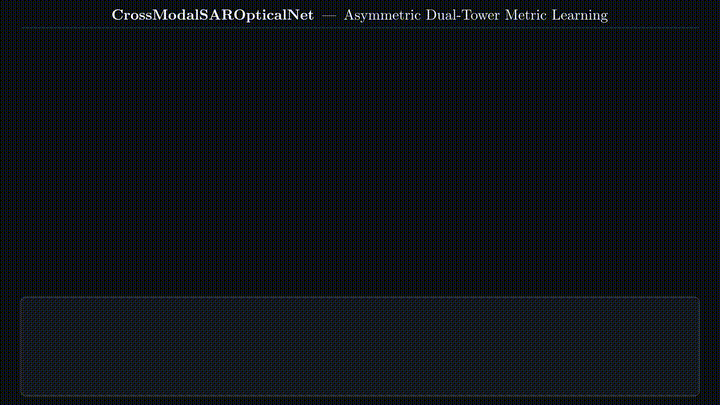

# 🛰️ Cross-Modal Satellite Image Retrieval

> **In plain English:** Two satellites look at the same field. One uses radar (like a bat), one uses a camera (like your phone). This project teaches an AI to understand that *both images show the same place*, so you can search a photo library using radar images (and vice versa).

<a href="https://youtu.be/CJNlx6B8aKc">
  
</a>

---

## 🗺️ Table of Contents

1. [The Big Picture — What Problem Are We Solving?](#1-the-big-picture)
2. [How the Two Satellites Work](#2-the-two-satellites)
3. [The Core Challenge — The Modality Gap](#3-the-modality-gap)
4. [The Dataset](#4-the-dataset)
5. [The Solution — Neural Network Architecture](#5-the-solution)
6. [The Math (Step by Step)](#6-the-math)
7. [How Retrieval Works at Inference Time](#7-retrieval-at-inference-time)
8. [Results](#8-results)
9. [Interactive Demos](#9-interactive-demos)
10. [Repository Structure](#10-repository-structure)
11. [How to Run](#11-how-to-run)
12. [Compiling the Technical Report](#12-compiling-the-technical-report)

---

## 1. The Big Picture

### What is "Image Retrieval"?

Imagine you have a **library of one million satellite images**. You want to find all images that look like a specific forest patch. Instead of tagging every image manually, you train a neural network to convert each image into a compact **fingerprint** (a list of 256 numbers, called an *embedding*). Images of similar places will have similar fingerprints. Searching then becomes: *"find the image whose fingerprint is closest to my query's fingerprint."*

### What is "Cross-Modal"?

There are two fundamentally different types of satellite:

| | Sentinel-1 (SAR / Radar) | Sentinel-2 (Optical / Camera) |
|:---|:---|:---|
| Works at night? | ✅ Yes | ❌ No |
| Works through clouds? | ✅ Yes | ❌ No |
| Sees colour? | ❌ No | ✅ Yes (13 bands) |
| Measures | Radar echo (geometry) | Reflected sunlight (colour) |

**Cross-modal** means: *can we use a radar image as a search query to retrieve matching optical images (and vice versa)?* This is hard because the two image types look completely different even when they show the same location.

```
Radar image of a city:    Optical image of the same city:
  ██░░░░██████              🟩🟫🟫🟩🟩
  ░░░░░░░░░░░░              🏙️🛣️🏙️🟫🟩
  ██░░░░░░░░░░              🏙️🏙️🏙️🏙️🟩
  ░░░░░░██████              🛣️🛣️🛣️🛣️🛣️
```

The goal: teach an AI that these two images, despite looking completely different, represent **the same place** and should have **similar fingerprints**.

---

## 2. The Two Satellites

### Sentinel-1 — The Radar Bat 🦇

Sentinel-1 is a **Synthetic Aperture Radar (SAR)** satellite. Like a bat using echolocation, it sends out microwave pulses and listens for the echo. The strength of the echo tells us about the surface.

- **Frequency:** 5.405 GHz (C-band), **wavelength** ≈ 5.55 cm

$$\lambda = \frac{c}{f_0} = \frac{3 \times 10^8 \text{ m/s}}{5.405 \times 10^9 \text{ Hz}} \approx 5.55 \text{ cm}$$

- **Resolution trick (SAR):** A real radar antenna would need to be *kilometres long* to achieve 10 m resolution from space. SAR fakes a giant antenna by synthesising the Doppler phase history as the satellite moves:

$$\delta_{\text{az,SAR}} = \frac{L_a}{2}$$

  So a 1-metre physical antenna achieves **0.5-metre azimuth resolution** — independent of altitude!

- **Two measurement channels:**
  - **VV** (Vertical-Vertical): good for smooth surfaces like water and bare soil
  - **VH** (Vertical-Horizontal, cross-polarised): good for vegetation and forests (the signal bounces around inside the canopy)

- **What different surfaces look like in radar:**
  - 💧 **Calm water** → pitch **black** (mirror-reflects radar away from satellite, σ⁰ < −25 dB)
  - 🌲 **Dense forest** → medium grey (VH signal high due to volumetric scattering)
  - 🏢 **Buildings** → very **bright** (corner reflectors bounce radar straight back, σ⁰ > 0 dB)

### Sentinel-2 — The Camera 📷

Sentinel-2 carries a **Multi-Spectral Instrument (MSI)** — essentially a very precise camera that records 13 colour bands (including infrared, which our eyes can't see). It measures sunlight reflected from Earth's surface.

The raw number stored per pixel is surface **reflectance** ρ, calculated as:

$$\rho_\lambda = \frac{\pi \cdot L_{\lambda,\text{surface}}}{E_{0,\lambda} \cdot \cos\theta_s}$$

where $L_{\lambda,\text{surface}}$ is the light reaching the sensor, $E_{0,\lambda}$ is the solar irradiance above the atmosphere, and $\theta_s$ is the sun angle.

The **10 bands** we use, resampled to a common 10 m/pixel grid:

| Band | Colour | Wavelength | What it sees |
|:---:|:---|:---:|:---|
| B02 | Blue | 490 nm | Soil, atmosphere scattering |
| B03 | Green | 560 nm | Healthy green vegetation (peak reflectance) |
| B04 | Red | 665 nm | Chlorophyll absorption (plants look dark) |
| B05–B07 | Red Edge | 705–783 nm | Vegetation stress, canopy structure |
| B08 | NIR (broad) | 842 nm | Leaf cell scattering (basis of NDVI) |
| B8A | NIR (narrow) | 865 nm | Fine vegetation detail |
| B11 | SWIR | 1610 nm | Soil moisture, minerals |
| B12 | SWIR | 2190 nm | Plant moisture, mineral composition |

### Why They Are So Different

| Property | Sentinel-1 SAR | Sentinel-2 Optical |
|:---|:---|:---|
| Energy source | *Active* — emits its own microwave | *Passive* — measures reflected sunlight |
| Cloud penetration | ✅ Completely transparent | ❌ Completely blocked |
| Works at night | ✅ Yes | ❌ No |
| Channels | 2 (VV, VH in dB) | 10 (reflectance 0–1) |
| Measures | Surface roughness, geometry, dielectric constant | Colour, biochemical composition, moisture |

This extreme physical difference creates what researchers call the **modality gap** — the central challenge of this project.

---

## 3. The Modality Gap

### What Is "Cone Collapse"?

When you train a neural network to match SAR and optical images, something bad tends to happen. Even if the network is doing a decent job overall, it learns that **"radar images look like radar images, and optical images look like optical images"**. It ends up packing all SAR embeddings into one tight cluster (a "cone") in the 256-dimensional space, and all optical embeddings into a *completely separate* cone:

```
                   Latent Space (256 dimensions, simplified to 2D):

           SAR embeddings        Optical embeddings
               ████                   ████
              ██████                 ██████
             ████████               ████████
                ↑                      ↑
         SAR cone                 Optical cone
         (completely              (completely
          separate!)               separate!)
```

If you then search for a radar image in a gallery that contains **both** radar and optical images, the top results are always radar images — because the radar fingerprints are closer to each other than to any optical image. Cross-modal retrieval fails completely.

### Why We Can't Just Cheat

A common (but **wrong**) fix is **transductive centering**: compute the average fingerprint of all SAR test images and all optical test images, then subtract the respective averages to merge the two cones. This "cheats" because:

1. In a real deployment, queries arrive **one at a time** — you can't use future query data.
2. Using the **test set to calibrate** means your evaluation is measuring how well you can exploit the test set, not how well the model generalises.

### The Right Fix — Frozen Inductive Centering

We compute the calibration centroids (average embeddings) exclusively on the **validation set** (data that was never used for training):

$$\boldsymbol{\mu}_{\text{SAR}} = \frac{1}{N_{\text{val}}} \sum_{i=1}^{N_{\text{val}}} f_{\text{SAR}}(\mathbf{x}_{i}^{\text{val}}), \quad \boldsymbol{\mu}_{\text{Opt}} = \frac{1}{N_{\text{val}}} \sum_{i=1}^{N_{\text{val}}} f_{\text{Opt}}(\mathbf{x}_{i}^{\text{val}})$$

These centroids are then **frozen** (locked, never updated again). At test time, every new embedding is shifted by its frozen centroid and re-normalized:

$$\hat{\mathbf{z}}_m = \frac{\mathbf{z}_m - \boldsymbol{\mu}_m}{\|\mathbf{z}_m - \boldsymbol{\mu}_m\|_2}$$

This merges the two cones without touching the test set. It's the difference between a *rigorous scientific experiment* and an *inflated benchmark score*.

---

## 4. The Dataset

We use **BigEarthNet-14K** (Kaggle: `narendraaironi/bigearthnet-14k`).

| Metric | Value |
|:---|:---|
| Total image pairs | 13,683 co-registered SAR + optical pairs |
| Total TIFF files | 27,366 |
| Training pairs | 7,180 |
| Validation pairs | 3,255 |
| Test pairs | 3,248 |
| Land cover labels | 43-class CORINE taxonomy (multi-label) |
| SAR image size | 2 channels × 120 × 120 pixels |
| Optical image size | 10 channels × 120 × 120 pixels |

**Co-registered** means each SAR image and its matching optical image cover *exactly* the same geographic patch, pixel by pixel. The filename matching convention is:

- S1 TIFF basename ↔ `s1_name` column in `metadata.parquet`
- S2 TIFF basename ↔ `patch_id` column in `metadata.parquet`

**Multi-label**: Each patch can have multiple land-cover labels simultaneously. For example, a patch might be labelled `{Broad-leaved forest, Water courses, Pastures}` all at once. This is key to the loss function design.

---

## 5. The Solution

### High-Level Architecture

The system uses an **asymmetric dual-tower** design with **four** neural networks (two pairs of online/target):

```
                     ┌─────────────────────────────────────────────┐
                     │  TRAINING PIPELINE                          │
                     │                                             │
  SAR Image ─────────┼──► SAR Online Encoder ──► z_S1 (256-d)    │
  (2ch, 120×120)     │         ↕ EMA update                       │
                     │    SAR Target Encoder ──► t_S1 (256-d)     │
                     │                                             │
  Optical Image ─────┼──► Opt Online Encoder ──► z_S2 (256-d)    │
  (10ch, 120×120)    │         ↕ EMA update                       │
                     │    Opt Target Encoder ──► t_S2 (256-d)     │
                     │                                             │
                     │  Loss = InfoNCE(z_S1 ↔ t_S2)               │
                     │       + InfoNCE(z_S2 ↔ t_S1)  (cross-modal)│
                     │       + InfoNCE(z_S1 ↔ t_S1)               │
                     │       + InfoNCE(z_S2 ↔ t_S2)  (self-distil)│
                     └─────────────────────────────────────────────┘
```

### ConvNeXt-Tiny Backbone

Each encoder uses **ConvNeXt-Tiny**, a modern convolutional network pre-trained on ImageNet. The network was originally designed for 3-channel RGB images. We adapt it:

- **SAR (2 channels):** Average the 3 RGB pretrained filter weights into 1, repeat it twice.
- **Optical (10 channels):** Tile the 3 RGB filters 4 times to cover 10 channels, then scale down by 3/10 to keep the same energy.

### Online vs. Target Networks

- **Online networks** see the *augmented* (randomly flipped/rotated) version of an image and are updated by **backpropagation** (the normal training gradient).
- **Target networks** see the *original* version and are updated by **EMA** (Exponential Moving Average) — a slow, stable copy of the online network:

$$\theta_k \leftarrow m \cdot \theta_k + (1 - m) \cdot \theta_q, \quad m = 0.996$$

This means target networks change slowly (99.6% of old weights kept each step), giving the online networks a stable "teacher" to learn from.

### Generalized Mean (GeM) Pooling

After the ConvNeXt backbone, we have a 3D feature map (768 channels × 3 × 3 spatial). Standard **Global Average Pooling** simply averages everything — this dilutes important local features (like a small bridge). **GeM Pooling** uses a learnable exponent $p$:

$$\mathbf{g} = \left( \frac{1}{H'W'} \sum_{u,v} \max(\mathbf{F}_{:,u,v},\, \epsilon)^p \right)^{1/p}$$

- When $p=1$: same as average pooling
- When $p \to \infty$: same as max pooling (keeps only the strongest activation)
- When $p=3$ (our init): emphasizes bright local features while keeping some context

The network **learns** the best $p$ during training.

### Projection Head

After GeM pooling, a small MLP compresses the features to 256 dimensions:

$$\text{Linear}(768 \to 512) \to \text{BatchNorm} \to \text{GELU} \to \text{Dropout}(0.1) \to \text{Linear}(512 \to 256)$$

The final step: **L2-normalize** so every embedding has length exactly 1.0, placing it on a 256-dimensional sphere (the "unit hypersphere"):

$$\mathbf{z} = \frac{\phi(\mathbf{g})}{\|\phi(\mathbf{g})\|_2}$$

On this sphere, **cosine similarity = dot product**, which is easy to compute.

---

## 6. The Math

### Step 1 — Radiometric Normalization

Before feeding images to the network, we normalize the raw pixel values to [0, 1]:

**SAR (Sentinel-1):**
Raw values are in decibels (dB). We clip to a physically meaningful range [−35, 0] dB (noise floor to corner reflectors) and linearly map to [0, 1]:

$$\tilde{\mathbf{X}}_{\text{S1}} = \frac{\text{clip}(\mathbf{X}_{\text{S1}},\; -35.0,\; 0.0) + 35.0}{35.0}$$

**Optical (Sentinel-2):**
Raw values are surface reflectance × 10,000. Divide by 10,000 and clip to [0, 1]:

$$\tilde{\mathbf{X}}_{\text{S2}} = \text{clip}\!\left(\frac{\mathbf{X}_{\text{S2}}}{10000.0},\; 0.0,\; 1.0\right)$$

### Step 2 — Synchronized Data Augmentation

During training, we randomly flip and rotate images to teach the network that orientation doesn't matter. Crucially, the **same transformation** is applied to *both* the SAR and optical image of a pair (the **dihedral group D₄**: 4 rotations × 2 flips = 8 transformations):

$$(X_{\text{S1}}^{\text{aug}},\; X_{\text{S2}}^{\text{aug}}) = (T(X_{\text{S1}}),\; T(X_{\text{S2}})), \quad T \in D_4$$

If we applied different flips to the two images, a river going left-to-right in the radar image would match a river going top-to-bottom in the optical image — breaking the correspondence.

### Step 3 — Pairwise Jaccard (IoU) Masking

**The problem:** Standard contrastive learning treats every non-matching image in the batch as a *negative* (something to push away). But what if two images in the same batch both show "Coniferous Forest + River"? Pushing them apart is **wrong** — they're genuinely similar.

**The fix:** Compute the semantic overlap (Jaccard Index / Intersection-over-Union) between every pair of label sets in the batch:

$$\text{IoU}_{i,j} = \frac{|Y_i \cap Y_j|}{|Y_i \cup Y_j| + 10^{-8}}$$

For example:
- Image A: `{Forest, River}`, Image B: `{Forest, River}` → IoU = 2/2 = **1.0** (identical)
- Image A: `{Forest, River}`, Image C: `{Urban, Roads}` → IoU = 0/4 = **0.0** (completely different)
- Image A: `{Forest, River}`, Image D: `{Forest, Pastures}` → IoU = 1/3 = **0.33**

If IoU > 0.40 and i ≠ j, we build a **mask** to suppress these "false negative" pairs:

$$\mathcal{M}_{i,j} = \mathbb{1}(\text{IoU}_{i,j} > 0.40 \;\text{AND}\; i \neq j)$$

### Step 4 — Masked InfoNCE Loss

**InfoNCE** (Information Noise Contrastive Estimation) is the core contrastive loss. For a batch of $B$ pairs, it asks the network to pick the matching sample (the "positive") from $B$ candidates — like a multiple-choice test with $B$ options.

For online embedding $\mathbf{u}_i$ (SAR) and target embedding $\mathbf{v}_j$ (Optical), the **masked logits** are:

$$\tilde{\ell}_{i,j} = \begin{cases} -10^9 & \text{if } \mathcal{M}_{i,j} = 1 \quad (\text{false negative — ignore}) \\ \dfrac{\mathbf{u}_i^\top \mathbf{v}_j}{\tau} & \text{otherwise} \end{cases}$$

where $\tau = 0.1$ is the **temperature** (smaller = sharper distinction between positives and negatives).

The masked InfoNCE loss for the full batch:

$$\mathcal{L}_{\text{InfoNCE}}(\mathbf{U}, \mathbf{V}) = \frac{1}{2B} \sum_{i=1}^{B} \left[ \underbrace{-\frac{\mathbf{u}_i^\top \mathbf{v}_i}{\tau}}_{\text{pull positive together}} + \underbrace{\log \sum_{j=1}^{B} \exp(\tilde{\ell}_{i,j})}_{\text{push negatives away}} \right] + \text{(symmetric term)}$$

Intuition:
- The **first term** maximizes the dot product between matching pairs (pull them together on the hypersphere).
- The **second term** (the log-sum-exp) minimizes the dot product with everything else (push non-matching pairs apart).
- Masked pairs ($\mathcal{M}=1$) are set to $-10^9$ so $\exp(-10^9) \approx 0$ — they're completely ignored.

### Step 5 — Composite Loss (Four Contrastive Terms)

We train with 4 contrastive pairs simultaneously:

$$\mathcal{L}_{\text{total}} = \underbrace{\frac{1}{2}\Big(\mathcal{L}(Z_{\text{S1}}, T_{\text{S2}}) + \mathcal{L}(Z_{\text{S2}}, T_{\text{S1}})\Big)}_{\text{cross-modal alignment (weight 0.5)}} + \underbrace{\frac{1}{4}\Big(\mathcal{L}(Z_{\text{S1}}, T_{\text{S1}}) + \mathcal{L}(Z_{\text{S2}}, T_{\text{S2}})\Big)}_{\text{intra-modal self-distillation (weight 0.25)}}$$

- **Cross-modal terms (weight ½ each):** SAR online ↔ Optical target, and Optical online ↔ SAR target. These are the main drivers of cross-sensor alignment.
- **Self-distillation terms (weight ¼ each):** SAR online ↔ SAR target, Optical online ↔ Optical target. These prevent the representations from collapsing by keeping each modality internally consistent.

---

## 7. Retrieval at Inference Time

After training, we build a **gallery** of embeddings for all test images:

```
1. Encode all 3,248 test SAR images  → 3,248 vectors of shape [256]
2. Encode all 3,248 test Optical images → 3,248 vectors of shape [256]
3. Apply Frozen Inductive Centering (shift + re-normalize)
4. Stack into one FAISS index: 6,496 total items
```

To search, we:

1. Encode the query image → 256-d vector
2. Apply inductive centering → re-normalize
3. Use **FAISS** (`IndexFlatIP`) to find the top-K nearest vectors by dot product (= cosine similarity for unit vectors)
4. Return the top-K images, filtered to remove exact self-matches

**Why FAISS?** Facebook AI Similarity Search is a library that can search through millions of vectors in milliseconds. The notebook uses `faiss-cpu`; its reported search time for 6,496 vectors in 256 dimensions is **~0.8 ms** and depends on the runtime hardware.

### End-to-End Latency (NVIDIA T4 encoding, CPU FAISS search)

| Step | Time |
|:---|:---:|
| ConvNeXt-Tiny encoding (FP16) | ~4.2 ms |
| Inductive centering + L2 normalization | ~0.1 ms |
| FAISS CPU search over 6,496 items | ~0.8 ms |
| **Total** | **~5.1 ms** |

---

## 8. Results

### Does Calibration Help?

| Configuration | Geo R@1 | Geo R@5 | Geo R@10 | Semantic F1@5 |
|:---|:---:|:---:|:---:|:---:|
| **No calibration** (raw embeddings) | 21.31% | 46.09% | 58.25% | 0.7309 |
| **Frozen Inductive Centering** ✅ | **21.60%** | **46.44%** | **58.71%** | **0.7313** |
| *(Cheating) Transductive centering* | *(21.89%)* | *(47.06%)* | *–* | *–* |

> **Key insight:** The uncalibrated model already avoids full cone collapse (thanks to the composite loss + EMA-synced BatchNorm). Frozen Inductive Centering gives a consistent +0.3–0.5% boost without touching the test set. The "cheating" transductive method gives only slightly better numbers — confirming that our honest method is essentially as good.

### SAR vs. Optical as Query

| Query Modality | Geo R@1 | Geo R@5 | Semantic F1@5 |
|:---|:---:|:---:|:---:|
| **SAR → Gallery** | **22.60%** | **47.97%** | 0.7259 |
| **Optical → Gallery** | 20.60% | 44.92% | **0.7367** |

- **Radar is better at finding exact geographic matches** (higher Geo R@K): Radar sees hard corners, coastlines, and geometric structures that are unique fingerprints for a specific location.
- **Optical is better at finding semantically similar images** (higher F1): 10 spectral bands capture subtle vegetation differences between, e.g., pine forest vs. oak forest.

### Performance by Land Cover Type

| Land Cover | Geo R@1 | Geo R@5 | Why |
|:---|:---:|:---:|:---|
| **Water Bodies** | **37.67%** | **67.59%** | Water = pitch black in radar + strong NIR absorber in optical → unmistakable |
| **Agricultural** | 24.51% | 50.49% | Clear field boundaries in both modalities |
| **Urban / Industrial** | 21.18% | 45.51% | Strong corner reflectors in radar, distinct road networks |
| **Woodland / Shrub** | 21.68% | 46.91% | Medium performance |
| **Forests** | 17.39% | 40.37% | Uniform canopy in both modalities → hard to distinguish individual patches |

---

## 9. Interactive Demos

| Demo | What It Shows | Live Link |
|:---|:---|:---|
| [**Satellite Working**](./demos/satellite_working.md) | Animated simulation of how Sentinel-1 and Sentinel-2 physically capture images | [Launch →](https://p-retrover.github.io/cross-modal-satellite-image-retrieval/demos/sentinel_1_vs_sentinel_2_isometric_technical_figure) |
| [**InfoNCE Hypersphere Centrifuge**](./demos/centrifuge_demo.md) *(incomplete)* | 3D WebGL simulation showing how the Jaccard masking prevents false negatives in the latent space | [Launch →](https://p-retrover.github.io/cross-modal-satellite-image-retrieval/demos/masked_infonce_centrifuge_jaccard_gate) |

---

## 10. Repository Structure

```
cross-modal-satellite-image-retrieval/
│
├── README.md                          ← You are here
├── implementation.md                  ← Detailed implementation notes & planning log
│
├── cross_modal_satellite_retrieval_sanitized.ipynb
│   └── The main Jupyter notebook: data loading, model, training, evaluation
│
├── build.sh                           ← Script to compile the PDF technical report
├── metadata.yaml                      ← PDF report metadata (author, title, abstract)
├── template.tex                       ← XeLaTeX PDF template
├── ieee.csl                           ← IEEE citation style
├── references.bib                     ← BibTeX references
│
├── sections/                          ← Technical report chapters (Markdown)
│   ├── 01_foundational_physics.md     ← SAR physics, optics, sensor comparison
│   ├── 02_literature_survey.md        ← Related work, InfoNCE, momentum networks
│   ├── 03_data_engineering_and_preprocessing.md  ← Dataset, normalization, augmentation
│   ├── 04_neural_architecture_and_math.md        ← ConvNeXt, GeM, InfoNCE math
│   ├── 05_inductive_evaluation_and_faiss.md      ← Evaluation protocol, FAISS
│   ├── 06_results_ablations_and_diagnostics.md   ← Results tables, visual outputs
│   ├── 07_appendices.md               ← CORINE labels, hyperparams, code listings
│   └── 08_references.md               ← Bibliography
│
├── images/
│   ├── retrieval_images/              ← Example retrieval output panels
│   ├── rsir_network.svg               ← Literature taxonomy diagram
│   ├── training_pipeline_final.svg    ← Training architecture diagram
│   ├── sar_target_encoder.onnx.svg    ← SAR encoder computational graph
│   └── opt_target_encoder.onnx.svg    ← Optical encoder computational graph
│
├── animation/
│   ├── cross_modal_manim.py           ← Manim animation source code
│   ├── animation_documentation.md     ← How to render the animation
│   └── preview.gif                    ← Preview of the training pipeline animation
│
└── demos/
    ├── satellite_working.md           ← Notes on the satellite physics demo
    ├── centrifuge_demo.md             ← Notes on the InfoNCE demo
    ├── sentinel_1_vs_sentinel_2_isometric_technical_figure.html  ← Satellite demo
    └── masked_infonce_centrifuge_jaccard_gate.html               ← Centrifuge demo
```

---

## 11. How to Run

### Training (Google Colab — Recommended)

The full training pipeline lives in a single Jupyter notebook optimized for cloud execution:

**Notebook:** `cross_modal_satellite_retrieval_sanitized.ipynb`

1. Go to [Google Colab](https://colab.research.google.com/)
2. Upload `cross_modal_satellite_retrieval_sanitized.ipynb`
3. Set Runtime → Change runtime type → **GPU** (T4 or L4, 16 GB VRAM)
4. Run cells from top to bottom

The notebook automatically:
- Downloads the Kaggle dataset
- Extracts and verifies the TIFF files
- Installs required packages (`faiss-cpu`, `graphviz`, etc.)
- Trains the dual-tower model for 30 epochs
- Evaluates on the test set

**Hardware requirement:** A single NVIDIA T4 or L4 GPU with 16 GB VRAM. Free Colab GPU is sufficient.

> **Note:** Colab's `/content` storage is temporary. Save checkpoints and results to Google Drive.

### Key Dependencies

```python
torch          # Deep learning framework
torchvision    # ConvNeXt backbone, pretrained weights
faiss-cpu      # Exact inner-product vector search
rasterio       # Reading GeoTIFF satellite images
pandas         # Metadata handling
numpy          # Numerical operations
matplotlib     # Visualization
```

---

## 12. Compiling the Technical Report

The full research article is written in modular Markdown files under `sections/` and compiled into a publication-grade PDF using **Pandoc** + **XeLaTeX**.

### Install Prerequisites

**Ubuntu / Debian:**

```bash
sudo apt update
sudo apt install pandoc texlive-xetex
```

Ubuntu 22.04 provides Pandoc 2.9, which needs the separate citation filter:

```bash
sudo apt install pandoc-citeproc
```

Newer Pandoc releases include citation processing and do not need that extra package.

**Fedora Linux:**

```bash
sudo dnf install pandoc texlive-scheme-basic texlive-xetex
```

### Build the PDF

```bash
chmod +x build.sh
./build.sh
```

The script:
1. Creates the `build/` directory
2. Runs Pandoc, feeding all `sections/*.md` files in numerical order
3. Uses `template.tex` for publication typography
4. Resolves citations from `references.bib` using IEEE style (`ieee.csl`)
5. Outputs the final PDF to `build/final_technical_report.pdf`

### Build Script Explained (`build.sh`)

```bash
pandoc metadata.yaml \          # Author, title, date, abstract
    sections/*.md \             # All chapter files (sorted alphabetically = numerical order)
    --template=template.tex \   # XeLaTeX template for page layout & typography
    --pdf-engine=xelatex \      # Use XeLaTeX (supports Unicode and modern fonts)
    --top-level-division=chapter \  # Map Markdown H1 (#) to LaTeX chapters
    --toc \                     # Generate a Table of Contents
    --number-sections \         # Auto-number all sections (1.1, 1.2, etc.)
    --citeproc \                # Process [@citation] references automatically
    -o build/final_technical_report.pdf
```

---

## Glossary

| Term | Plain-English Meaning |
|:---|:---|
| **SAR** | Synthetic Aperture Radar — a satellite that emits microwaves and measures their echo |
| **Optical** | A satellite that acts like a camera, measuring reflected sunlight |
| **Embedding / Latent Vector** | A compact list of numbers (here: 256) that represents an image's content |
| **Hypersphere** | An N-dimensional sphere. All our embeddings live on a 256-dimensional sphere (every vector has length exactly 1) |
| **Cosine Similarity** | Measures the angle between two vectors. 1.0 = identical direction, 0.0 = perpendicular, −1.0 = opposite |
| **InfoNCE** | A loss function that trains the network by asking it to identify the matching pair among many candidates |
| **EMA** | Exponential Moving Average — a way to slowly update network weights as a weighted average of old + new |
| **GeM Pooling** | Generalized Mean Pooling — a smarter way to summarize spatial features |
| **Jaccard Index / IoU** | Intersection over Union — measures overlap between two sets. 1.0 = identical sets, 0.0 = no overlap |
| **FAISS** | Facebook AI Similarity Search — a library for fast nearest-neighbour search over millions of vectors |
| **Modality Gap / Cone Collapse** | A failure mode where all SAR embeddings cluster in one part of the space and all optical embeddings in another |
| **Inductive Centering** | Correcting the modality gap by shifting embeddings using statistics from the *validation* set (not the test set) |
| **Transductive (the bad kind)** | Using statistics from the *test* set for calibration — this is data leakage and must be avoided |
| **CORINE** | Coordination of Information on the Environment — a European land-cover classification database with 43 classes |
| **Geo R@K** | Geographic Recall at K — did the exact geographic twin appear in the top K results? |
| **Dice@K / F1@K** | Semantic overlap between query labels and retrieved image labels, averaged over top-K results |
# cross-modal-satellite-image-retrieval-nndl
